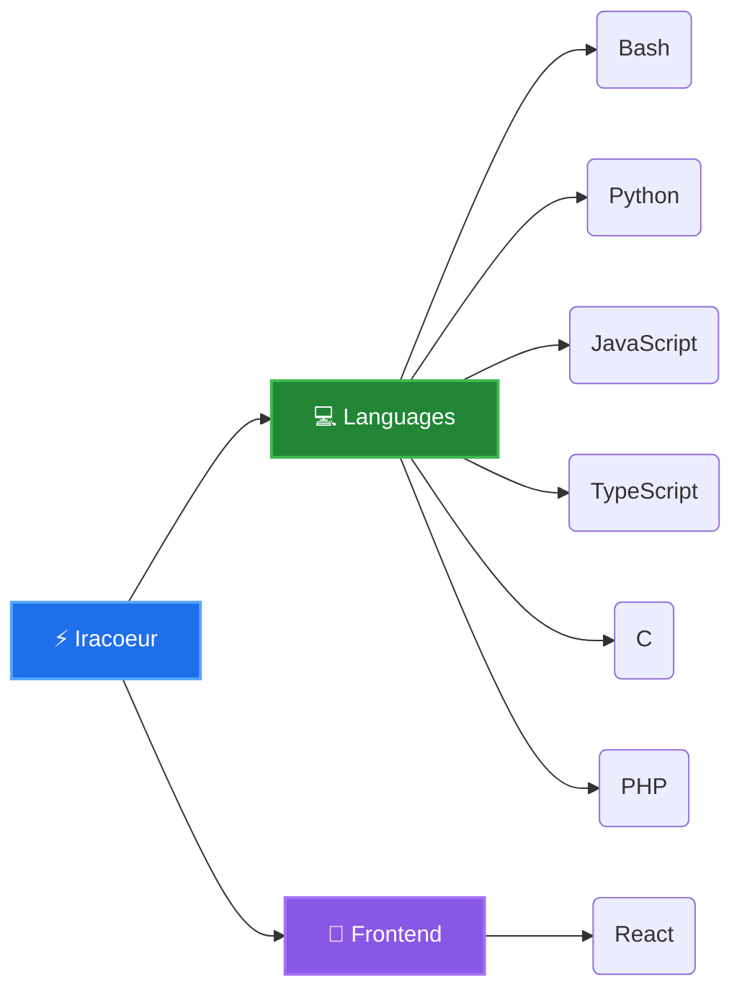

```text
 ___ ____      _    ____ ___  _____ _   _ ____  

|_ _|  _ \    / \  / ___/ _ \| ____| | | |  _ \ 
 | || |_) |  / _ \| |  | | | |  _| | | | | |_) |
 | ||  _ <  / ___ \ |__| |_| | |___| |_| |  _ < 
|___|_| \_\/_/   \_\____\___/|_____|\___/|_| \_\
```

```bash
\$ whoami
> Iracoeur — Software Developer & Digital Builder

\$ cat mission.txt
> Writing clean code, breaking things to see how they work, and building projects that matter.
```

> [!TIP]
> **Currently exploring:** Full-stack web architecture, systems programming in C, and Linux automation.

---

### 🧠 Tech Stack Architecture



---

### 📋 Developer Profile (`iracoeur.config.json`)

```json
{
  "name": "Iracoeur",
  "role": "Software Developer & Digital Builder",
  "core_languages": ["Bash", "Python", "JavaScript", "TypeScript", "C", "PHP"],
  "frameworks": ["React"],
  "focus": ["Clean Architecture", "Automation", "Problem Solving"],
  "open_to_collaborate": true
}
```
