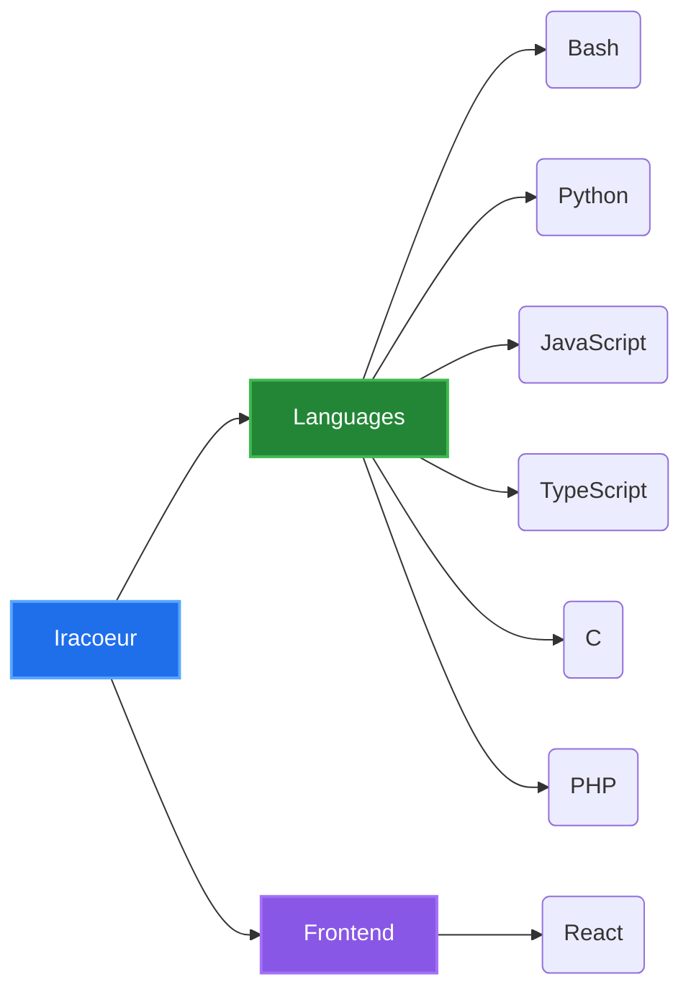

```text
 ___ ____      _    ____ ___  _____ _   _ ____  

|_ _|  _ \    / \  / ___/ _ \| ____| | | |  _ \ 
 | || |_) |  / _ \| |  | | | |  _| | | | | |_) |
 | ||  _ <  / ___ \ |__| |_| | |___| |_| |  _ < 
|___|_| \_\/_/   \_\____\___/|_____|\___/|_| \_\
```

```bash
\$ whoami
> Iracoeur — Software Developer

\$ cat about.txt
> Building reliable web applications, systems software, and automation tools.
```

---

### Tech Stack



---

### Focus Areas
* **Web Development:** Full-stack applications with **React**, **TypeScript**, **JavaScript**, and **PHP**
* **Automation & Scripting:** Command-line tools and workflows in **Bash** and **Python**
* **Systems Programming:** Performance-critical code in **C**
